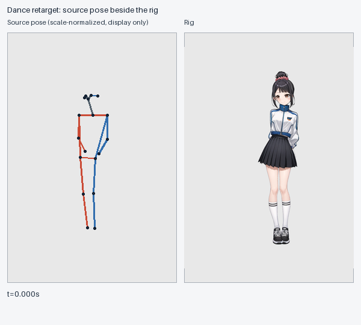

# @rig-c/pose

Puts motion from a pose onto a rig. The motion is joint positions over time: from a video, a dataset, or points placed by hand. The rig is one [rig-c](https://github.com/rig-c/core) built. A body-18 pose sequence becomes bone keys in rig-c's motion format, and the keys are checked before anything is written.

Part of the rig-c toolchain: [core](https://github.com/rig-c/core) compiles and gates a rig, [parts](https://github.com/rig-c/parts) builds one from a painting, [play](https://github.com/rig-c/play) plays it, and pose moves it. The rules behind every command, flag, file format and message on this page are in [docs/REFERENCE.md](docs/REFERENCE.md); **1.x keeps its promises**, and [What 1.x promises](RELEASING.md#what-1x-promises) says which surfaces are promised and which are courtesy.

<!-- demo -->

[](docs/demos/visible-retarget/README.md)

[A visible accepted take](docs/demos/visible-retarget/README.md): source skeleton beside the unchanged public rig at 600 px, with pinned source, commands and stage-labelled diagnostics. It is a 13-second take, not a loop. Historical pre-hand LAND 20/20 is separate from the v3 gate and current fold reading; shins 269/391 remains a visible known fold. Site placement is a separate sibling delivery.

## Try it

[`examples/wave`](https://github.com/rig-c/pose/tree/main/examples/wave) is in the repository, not the npm package: clone the repository, or copy its four files. It runs with nothing else: a bones-only stick rig (no art), a 3-second wave made from joint angles (`make-pose.ts` writes it), and the map that joins them.

```sh
rig-pose retarget --rig examples/wave/rig --map examples/wave/map.json --sequence examples/wave/pose.json --out wave.motion.json --build wave-build
```

`pose.json` is already cleaned (`make-pose.ts` passes it through `clean`). It prints the gate's verdict and where every mapped bone landed, then writes `wave.motion.json`, its report `wave.motion.report.json` and the gated build, with its record `retarget.json` beside it ([reference](docs/REFERENCE.md#the-builds-record-retargetjson)). `rigc preview --candidate wave-build` plays it in the Spine Web Player. A rig with no art shows only its bones.

## Choosing the approach

How far a retarget can carry a figure depends on the figure and on how intense the motion is ([#361](https://github.com/rig-c/pose/issues/361)):

| Figure | Mild motion (walk, idle, gesture) | Intense motion (run, dance) |
| --- | --- | --- |
| A designed character | retarget, plus frame parts where a frame reads wrong | part animation: replacement parts or frame parts swapped in on the frames that need them, sprite-like, placed with [`bind`](docs/REFERENCE.md#alternate-drawings-alternates) ([#360](https://github.com/rig-c/pose/issues/360)) and alternates; not one drawing bent through large angles |
| A mannequin or a super-deformed (SD) figure | retarget | full retarget, end to end: its proportions survive large rotations |

The exams use the mannequin. Expecting film-smooth intense motion from a designed character's single set of drawings is the wrong goal. The measured reason is that no procedural lever produced what the drawing lacked:

- **Back-kick** ([#357](https://github.com/rig-c/pose/issues/357)): on a run's back-kick frames only a drawn fold reads as the leg leaning back. The thigh's foreshortening and an end-on hold do not.
- **Knee up** ([#359](https://github.com/rig-c/pose/issues/359)): a thigh swinging toward the camera keeps its screen direction, so selection by direction alone can never pick a knee-up drawing. The card was parked in favour of drawing that frame part.
- **Pelvis below the cover** ([#342](https://github.com/rig-c/pose/issues/342)): a garment hides the tilt. The reader had to move below the cover, to the hem and the thigh roots, and a thigh drawn in front of the garment reads as its hem.
- **Draw order** ([#358](https://github.com/rig-c/pose/issues/358), closed without a change): on the run reference the crossing back foot is a near-end-on shin drawn at full length, not a shin drawn in the wrong order. No draw-order rule fixes a missing drawing.

The record of every lever tried on the way to this table, with its measurement, is [docs/JOURNEY-gait.md](https://github.com/rig-c/pose/blob/main/docs/JOURNEY-gait.md).

## What the rig needs

The map names **chains**: each limb as bones that descend from one another, parent to child. That means a thigh with its shin below it, and an upper arm with its forearm below it, and likewise for the trunk and the head. A rig whose arm is one bone, or that has no leg bones, cannot take a pose: the map is refused by name (`MAP_*`). [@rig-c/parts](https://github.com/rig-c/parts) builds such a rig from a painting's keypoints with `propose --keypoints`. A rig drawn by hand needs the same chains.

## Commands

`rig-pose retarget ... --shoulder-lift <file>` opts into [calibrated shoulder elevation](docs/REFERENCE.md#calibrated-shoulder-elevation---shoulder-lift).

The order is **clean → retarget**, with `pelvis` before `clean` when the drawing carries a pelvis tilt the detector lost, and `compare` after a render. Every command refuses by name and writes nothing when it refuses; `rig-pose --help` lists every flag. Exit codes are `0` written (for `compare`: compared), `1` refused, `2` bad invocation.

### `rig-pose clean`

```sh
rig-pose clean --pose dance.scan.json --out dance.pose.json [--loop] [--legs 5] [--rest 7] [--hold off] [--depth walk|run] [--coco] [--person <id>]
```

Takes the detector's shake out of a pose sequence — spikes, occluded joints, jitter, a joint that has stopped — and writes the sequence with a `cleaned` record saying what it did; `--loop` declares one gait cycle, `--depth walk|run` adds each limb segment's foreshortening as depth, `--coco` reads COCO-17 and converts it first. `retarget` reads only a sequence `clean` wrote. Rules: [Clean first](docs/REFERENCE.md#clean-first-rig-pose-clean), [Derived depth](docs/REFERENCE.md#derived-depth-clean---depth).

Before moving joints, `clean` always writes a measured figure-scale sidecar at `<out>.figure-scale.json` (`rig-pose-figure-scale/1`) and warns `CAMERA_UNDECLARED` when its spread exceeds 10% without a declared `camera`. A zoom can be read as body motion; pose foreshortening can also change this measurement. It neither fits nor corrects a camera and does not refuse the sequence. The sidecar binds the raw input and written sequence with SHA-256; the pose JSON format stays unchanged. Measurement and unknown-frame rules: [Clean first](docs/REFERENCE.md#clean-first-rig-pose-clean).

### `rig-pose pelvis`

```sh
rig-pose pelvis --pose dance.scan.json --frames frames/ --out dance.pelvis.json [--mode silhouette|waistband|below-cover]
rig-pose pelvis --pose dance.scan.json --pelvis-keys pelvis.keys.json --out dance.pelvis.json
```

Reads the pelvis tilt off the drawn frames (PNG, one per sequence frame) or takes it from a hand-keyed file, and writes it into the sequence as its own track, which `clean` then smooths and `retarget` keys; a frame it cannot read is marked, not guessed. It runs before `clean`. Rules: [The pelvis track](docs/REFERENCE.md#the-pelvis-track-rig-pose-pelvis).

### `rig-pose retarget`

```sh
rig-pose retarget --rig out/rig --map map.json --sequence dance.pose.json --out motion.json --animation dance [--build <dir>] [--report <file>]
```

Turns every mapped bone to follow its segment in the pose, moves the hip with the pelvis, switches in the map's alternate drawings where the pose matches them, runs rig-c's gate with the animation in, and writes one animation in rig-c's motion format with its report beside it — only when the gate is green and every bone landed where the pose asked. What it prints is the list of what it could not decide for you: holds, folds, seams, the moments that need another drawing. The optional flags cover the legs (`--leg-scale 0.8,1.05`, `--plant-feet`, `--stance 0.07`, `--contact-keys`), the switches (`--switch-tolerance 25`, `--switch-min 0.25`, `--switch-at peak`), the idle (`--carry-idle`, `--merge`), key reduction (`--reduce 1`, `--reduce-hip 1`), draw order (`--draw-order depth`) and how much it prints (`--summary`, `--verbose`). Rules: [What it does](docs/REFERENCE.md#what-it-does), [The legs](docs/REFERENCE.md#the-legs-foreshortening-and-planted-feet), [The idle](docs/REFERENCE.md#the-idle-what-the-retarget-drops), [Few keys](docs/REFERENCE.md#few-keys---reduce), [Draw order from depth](docs/REFERENCE.md#draw-order-from-depth---draw-order-depth), [The build's record](docs/REFERENCE.md#the-builds-record-retargetjson).

The two files you write for it:

- **The map** (`rig-pose-map/1`) says which bones carry which joints — the chains, the translated hip bone and its scale pair, and optionally each joint's `range`, the `alternates` (sets of drawings swapped in for a pose), a set's `bind` (the exact frames a replacement drawing shows on), `face`, `body` and `layout`. Rules: [The map](docs/REFERENCE.md#the-map-rig-pose-map1), [A joint's range](docs/REFERENCE.md#a-joints-range-range), [Alternate drawings](docs/REFERENCE.md#alternate-drawings-alternates).
- **The pose** (`rig-pose-sequence/1`) is body-18 joint positions per frame, in picture pixels, y down, with a state and a score per joint; `clean`, `pelvis` and the camera readers add their tracks to it. Rules: [The pose](docs/REFERENCE.md#the-pose-rig-pose-sequence1).

### `rig-pose convert`

```sh
rig-pose convert --coco in.json --out pose.json
```

Converts a COCO-17 sequence to `rig-pose-sequence/1` and nothing more; the output still needs `clean` (`clean --coco` does both in one step). Rules: [From COCO-17](docs/REFERENCE.md#the-pose-rig-pose-sequence1).

### `rig-pose compare`

```sh
rig-pose compare --reference ref.pose.json --render render.pose.json --map map.json [--retarget-report report.json] [--report compare.json] [--sheet compare.png]
```

Reads the detector's keypoints on the source video and on the rendered motion, on one time base, and lists where they differ per body unit — head, arms, body, legs, cloth — worst first, each with the fix it suggests; `--report` writes it as JSON and `--sheet` draws both skeletons at each finding's worst frame. A finding is not a failure: it exits 0 whenever it compared. Rules and the bars: [Compare](docs/REFERENCE.md#compare-the-rigs-render-against-the-video).

### `rig-pose cloth`

```sh
rig-pose cloth --rig build --map map.json --skirt-slots bottomwear [--animation dance] [--fps 24] [--windows 3.9-7.4,7.6-11.1] --out render.cloth.json
rig-pose cloth --frames skirt-frames/ --pose ref.pose.json [--alpha-min 16] [--windows 3.9-7.4,7.6-11.1] --out ref.cloth.json
```

Measures a skirt's cloth track (`rig-c-cloth-track/0`) from a built rig's posed skirt slots (`--rig`, stepped with `poseRawAnimationEach` and `physicsClockStep`, in rig world units) or from isolated skirt PNG frames beside a pose sequence (`--frames` + `--pose`, in picture px, using `--alpha-min` as the alpha threshold on transparent PNGs and as the RGB colour-distance threshold from the border median on opaque-background PNGs such as `rigc render --slot`, refusing a frame with no pixel above threshold as `CLOTH_EMPTY_FRAME`), normalised by the subject's median hip width, ready for `rig-pose compare --cloth-reference` and `--cloth-render`. Rules: [Measuring a cloth track](docs/REFERENCE.md#measuring-a-cloth-track-rig-pose-cloth).

## What it does not do

The full list, each limit resting on the open issue that holds it, is [What it does not do](docs/REFERENCE.md#what-it-does-not-do) in the reference. In short:

- **Extract poses from video.** The input is joint positions. How you get them is up to you: a pose model, a dataset, or by hand.
- **Turn the body.** It works in 2D only: a segment pointing at the camera foreshortens, and the rig cannot. The legs and the trunk can be scaled (`--leg-scale`), and a body turned past what a stretch can show is drawn by switching to a set the map declares.
- **Read depth where limbs cross.** Which limb passes in front of the torso, the skirt or the head is not read from the picture; depth comes from foreshortening alone.
- **Blinks, mouth shapes, hands and fingers.** No eyelid, mouth or finger key is written; body-18 has no hand points and the rig has no bones for them yet.
- **Track the camera from the video, or fit cloth physics to it.** A zoom or a pan is read from the sequence's `camera` field, written by the repository's `tools/` scripts, which are not shipped. A skirt's physics is the rig's own.

## Requirements

[Bun](https://bun.sh) ≥ 1.2 on `PATH` — rig-pose, like rig-c, runs its TypeScript sources directly. `rig-c` comes as a dependency. With `@esotericsoftware/spine-core` installed beside it, rig-c's gate runs the spine-core round trip; without it, rig-c's own gate, and the gate's report says which.

**The supported surface is the `rig-pose` command.** RELEASING.md's *What 1.x promises* lists every flag, report key, problem code and line tag as promised or courtesy, and why. The package exports no importable API: `exports` exposes only `package.json`.

## Licence

MIT, see `LICENSE`.
